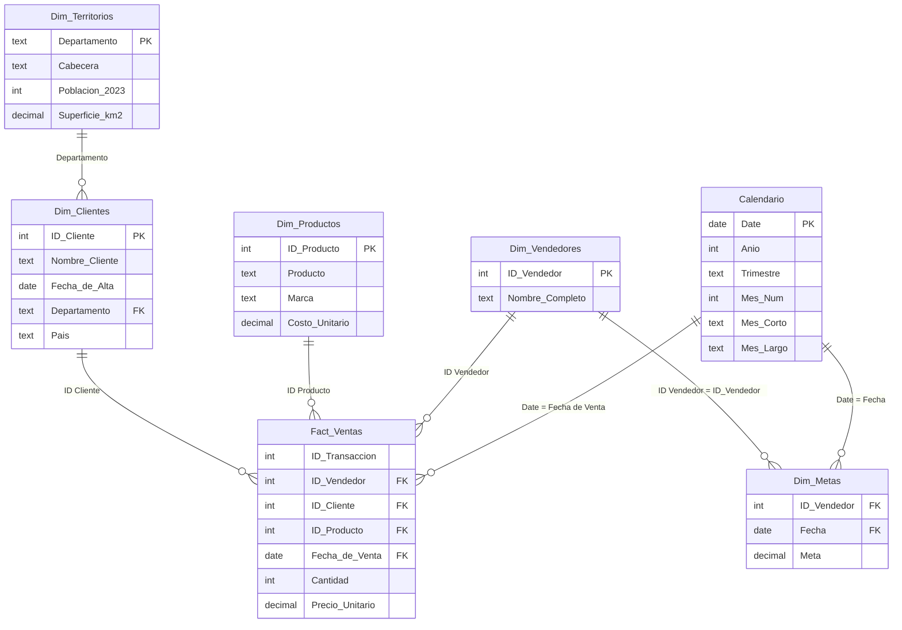

# Diagrama del modelo

Relaciones definidas en `pbip/Ventas.SemanticModel/definition/relationships.tmdl`. Todas son de muchos a uno (`*` hacia `1`), con filtro en una sola dirección (del lado "uno" al lado "muchos") y están activas.

## Relaciones

| # | Desde (muchos) | Hacia (uno) | Estado |
|---|---|---|---|
| 1 | `Fact_Ventas[ID Cliente]` | `Dim_Clientes[ID Cliente]` | Activa |
| 2 | `Fact_Ventas[ID Producto]` | `Dim_Productos[ID Producto]` | Activa |
| 3 | `Fact_Ventas[ID Vendedor]` | `Dim_Vendedores[ID Vendedor]` | Activa |
| 4 | `Fact_Ventas[Fecha de Venta]` | `Calendario[Date]` | Activa |
| 5 | `Dim_Metas[ID_Vendedor]` | `Dim_Vendedores[ID Vendedor]` | Activa |
| 6 | `Dim_Metas[Fecha]` | `Calendario[Date]` | Activa |
| 7 | `Dim_Clientes[Departamento]` | `Dim_Territorios[Departamento]` | Activa |

Además existe una relación automática de Power BI, `Dim_Clientes[Fecha de Alta]` hacia una tabla de fecha oculta (`LocalDateTable_*`). No forma parte del diseño.

## Cómo se propagan los filtros
- Un año o mes de `Calendario` filtra tanto `Fact_Ventas` como `Dim_Metas`.
- Un vendedor de `Dim_Vendedores` filtra `Fact_Ventas` y `Dim_Metas`. Así se puede comparar `Total Facturado` con `Meta` por vendedor.
- Un departamento de `Dim_Territorios` filtra `Dim_Clientes` y, a través de él, `Fact_Ventas`. Por eso el mapa de ventas usa `Dim_Territorios[Departamento]`.

## Columnas ocultas
Las llaves no se muestran en el panel de campos: `Fact_Ventas` (`ID Transacción`, `ID Vendedor`, `ID Cliente`, `ID Producto`, `Fecha de Venta`), `Dim_Clientes[ID Cliente]`, `Dim_Productos[ID Producto]`, `Dim_Vendedores[ID Vendedor]`, `Dim_Metas[ID_Vendedor]` y `Dim_Metas[Fecha]`. `Calendario[Date]` queda visible. `Departamento` (en `Dim_Clientes` y `Dim_Territorios`) tiene categoría de datos "Estado o provincia".